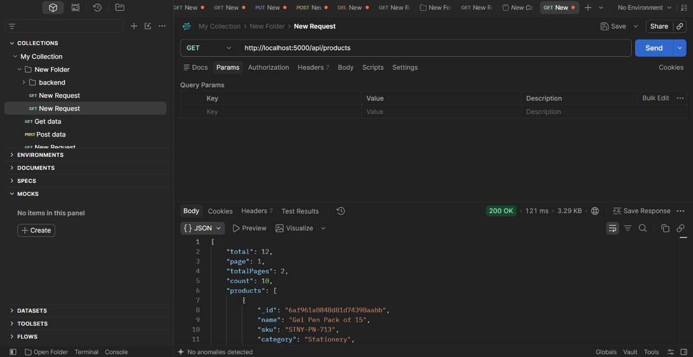
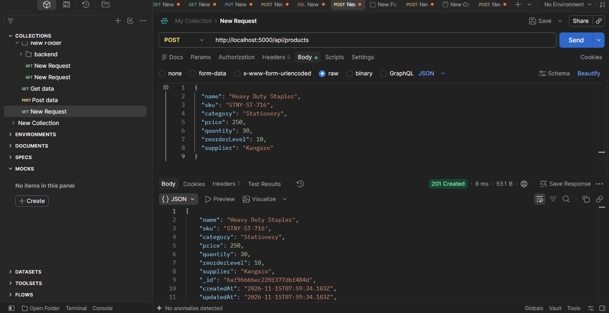
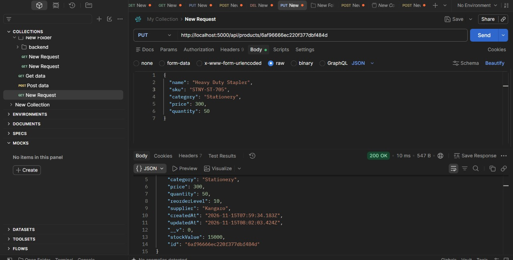
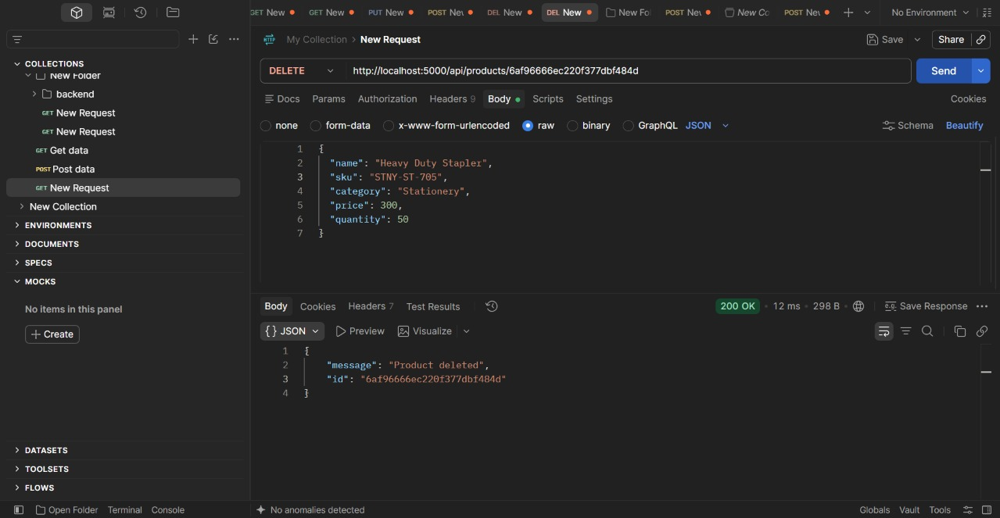
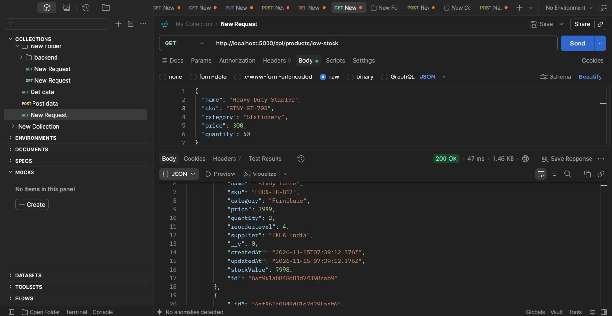
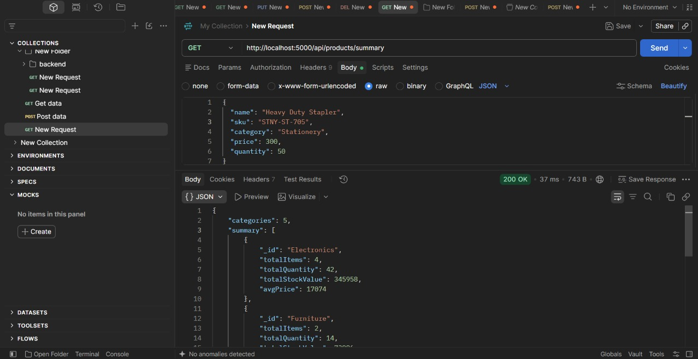
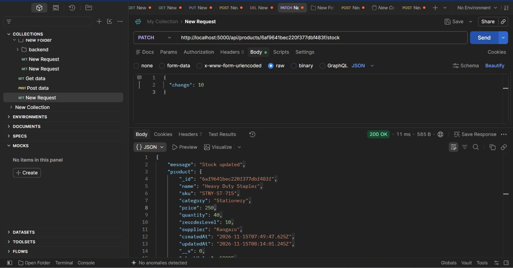

# Inventory and Data Management System

Web Dev III – Assignment 3 (Unit 3, CO3)
REST API built with **Node.js, Express.js, MongoDB, Mongoose and dotenv**.

## Features
- Mongoose schema with field-level validation (unique SKU, min/max, whole-number quantity)
- Full CRUD for products
- Filtering, sorting and pagination using query strings
- Safe stock restock / sale (atomic `$inc`, stock never goes negative)
- Aggregation pipelines: Low-Stock report and Category-wise summary
- Input validation middleware + centralized error handling
- Environment variables via dotenv

## Project Structure
```
inventory-management-system/
├── config/db.js
├── controllers/productController.js
├── middleware/errorHandler.js
├── middleware/validate.js
├── models/Product.js
├── routes/productRoutes.js
├── utils/AppError.js
├── utils/asyncHandler.js
├── screenshots/
├── seed.js
├── server.js
├── .env.example
└── package.json
```

## Setup
```bash
npm install
cp .env.example .env     # then edit MONGO_URI if needed
npm run seed             # optional: inserts 12 sample products
npm run dev              # or: npm start
```
Server runs on `http://localhost:5000`.

## Product Schema
| Field | Type | Rules |
|---|---|---|
| name | String | required, 2–100 chars |
| sku | String | required, unique, uppercase (A-Z, 0-9, -) |
| category | String | required |
| price | Number | required, >= 0 |
| quantity | Number | whole number, >= 0, default 0 |
| reorderLevel | Number | >= 0, default 10 |
| supplier | String | default "Unknown" |
| stockValue | Virtual | price × quantity |

## API Endpoints
| Method | Endpoint | Description |
|---|---|---|
| POST | `/api/products` | Create product |
| GET | `/api/products` | List with filter, sort, pagination |
| GET | `/api/products/:id` | Get single product |
| PUT | `/api/products/:id` | Update product details |
| PATCH | `/api/products/:id/stock` | Restock / sale (`{"change": 10}` or `{"change": -5}`) |
| DELETE | `/api/products/:id` | Delete product |
| GET | `/api/products/low-stock` | Products where quantity <= reorderLevel |
| GET | `/api/products/summary` | Category-wise inventory summary |

### Query parameters for `GET /api/products`
| Param | Example | Meaning |
|---|---|---|
| category | `?category=Electronics` | exact category (case-insensitive) |
| supplier | `?supplier=ikea` | partial match |
| search | `?search=pen` | partial match on name |
| minPrice / maxPrice | `?minPrice=100&maxPrice=5000` | price range |
| inStock | `?inStock=true` | quantity > 0 |
| sort | `?sort=-price,name` | `-` means descending |
| page / limit | `?page=2&limit=5` | pagination (limit max 100) |

### Sample request – Create product
```json
POST /api/products
{
  "name": "Gel Pen Pack of 15",
  "sku": "STNY-PN-713",
  "category": "Stationery",
  "price": 120,
  "quantity": 40,
  "reorderLevel": 20,
  "supplier": "Cello Pens"
}
```

## Postman Screenshots


### 1. Get All Products


### 2. Create Product


### 3. Update Product


### 4. Delete Product


### 5. Low-Stock Report


### 6. Category Summary


### 7. Stock Adjustment (PATCH)


## Author
Shraddha – KR Mangalam University
